# Desentral Projects & Civil Works — Website

Student web design project — Part 3: Enhancing Functionality and SEO.

A 6-page static HTML/CSS/JS website for Desentral Projects & Civil Works, a
Johannesburg-based construction and renovation company (est. 2015). No build
tools, frameworks, or backend server required — open `index.html` in any
browser and the whole site works, or visit the live GitHub Pages deployment
(see "Deployment" below).


## Folder structure

```
root/
|
|-- index.html              Home -- carousel, slideshow strip, services, CTA
|-- about.html               About -- company story, why-choose-us, FAQ accordion
|-- projects.html             Projects -- full photo gallery (58 photos), live
|                              search + trade filter, click-to-enlarge lightbox
|-- enquiry.html               Enquire -- validated enquiry form (was quote.html)
|-- contact.html                 Contact -- Leaflet/OpenStreetMap map (2 coverage
|                                  areas), validated general contact form
|-- admin.html                    Gallery Admin -- owner-only mockup, noindex,
|                                  not linked from public nav
|
|-- css/
|   |-- style.css            Site stylesheet -- layout, components, forms,
|   |                         map, gallery toolbar, lightbox, accordion
|   |-- leaflet.css            Leaflet's own stylesheet, vendored locally
|   `-- images/                 Leaflet's marker/layer icon images
|
|-- js/
|   |-- form-validation.js   Validates the enquiry + contact forms, builds an
|   |                         honest "here's what would be sent" preview
|   |-- contact-map.js         Initialises the Leaflet map on contact.html
|   |-- gallery-filter.js      Live search + trade-tag filtering on projects.html
|   |-- lightbox.js            Click-to-enlarge photo viewer on projects.html
|   |-- accordion.js           FAQ accordion on about.html
|   `-- leaflet.js             Leaflet 1.9.4, vendored locally (no CDN)
|
|-- images/                   All project photos (Facebook exports + originals)
|   `-- responsive/            Resized 480w/800w/1200w variants for srcset
|
|-- screenshots/               Desktop/tablet/mobile evidence for this README
|
|-- sitemap/
|   `-- sitemap.JPG             Site structure diagram (Part 1)
|
|-- wireframes/                 Low-fidelity layout mockups (PowerPoint, Part 1)
|
|-- robots.txt                 Search-engine crawl rules (blocks admin.html)
|-- sitemap.xml                 XML sitemap of the public pages
|
`-- README.md                   This file
```


## What Part 3 added

Part 1 delivered semantic HTML; Part 2 added the external stylesheet and
responsive design with **no JavaScript at all**, by design, since that
brief was CSS-only. Part 3's brief is "Enhancing Functionality and SEO",
which calls for real interactivity, so JavaScript is introduced deliberately
here — it's a new part of the module, not a reversal of Part 2's scope.
The CSS-only nav toggle and carousel from Part 2 are untouched; everything
below is new.

### Page structure changes
- **`quote.html` renamed to `enquiry.html`** and re-scoped as the
  service-specific enquiry form (name, phone, suburb, service needed,
  message) — the brief's "Quote / Enquiry" page.
- **New `contact.html`** added as a separate page per the brief: an
  interactive map with more than one location, business contact details,
  and a general-purpose contact form (name, email, message type, message).
- Every page's nav and footer updated to include both `enquiry.html` and
  `contact.html`, with `aria-current="page"` set correctly per page.
- Added a missing `<main>` wrapper around the primary content of every
  page (was absent in the Part 2 submission).

### Interactive maps (contact.html)
- **Leaflet 1.9.4 + OpenStreetMap** tiles, vendored locally in `js/leaflet.js`
  and `css/leaflet.css` (downloaded via npm, not loaded from a CDN, to stay
  consistent with this project's "no third-party CDN links" approach) —
  see References below for the required attribution.
- `js/contact-map.js` plots **two markers** — Johannesburg CBD and Kempton
  Park, Ekurhuleni — satisfying the brief's "more than one location"
  requirement, with popups naming each coverage area.

### Forms (enquiry.html, contact.html)
- Both forms use real HTML5 + JavaScript validation (`js/form-validation.js`):
  required fields, a minimum-length check on free-text fields, an email
  format check, and a phone-number pattern.
- On a valid submit, the script compiles the entered data into a preview of
  what an email/notification would contain, and displays it in the page.
  **Nothing is actually sent** — there's no backend behind either form —
  and both pages say this plainly in the form's note text and the response
  itself, rather than pretending to submit. This mirrors the honest
  no-JS-backend approach used for the WhatsApp link in Part 2.
- A WhatsApp link sits next to each form as the one path that reaches the
  business for real, right now.

### Gallery search, filtering and lightbox (projects.html)
- Every one of the 58 project cards carries a `data-category` attribute
  matching its existing trade tag (Electrical, Roofing, Bathrooms, …).
- `js/gallery-filter.js` adds a live search box (matches on heading,
  caption and tag text) and a row of trade-filter buttons, with a live
  "Showing X of 58 projects" count.
- `js/lightbox.js` opens a full-size view of any gallery photo on click,
  with previous/next navigation, a visible caption, and `Esc`/arrow-key
  support — restricted to whichever cards the search/filter has left
  visible.

### Interactive elements (about.html)
- A four-question **FAQ accordion** (`js/accordion.js`), built with
  `aria-expanded`/`aria-controls`/`hidden` kept in sync so it's usable with
  a screen reader, not just visually. Only one answer stays open at a time.

### SEO
- Added `<meta name="keywords">` to every public page (it was previously
  only on `enquiry.html`/`contact.html`).
- Reviewed every page's `<title>` and `<meta name="description">` for
  accuracy against its actual current content.
- Added `robots.txt` (allows the site, disallows `admin.html`) and
  `sitemap.xml` listing the five public pages — `admin.html` is correctly
  left out of both, since it already carries `<meta name="robots"
  content="noindex, nofollow">`.
- Confirmed every image site-wide already carries descriptive alt text and
  a descriptive filename (inherited from Parts 1–2), and that internal
  links between all six pages resolve correctly (checked programmatically,
  see "Testing" below).
- One `<h1>` per page, with a consistent `h1 → h2 → h3` hierarchy.


## Deployment (GitHub Pages)

This is a static site with no build step, so GitHub Pages serves it as-is:

1. Push this folder's contents to a GitHub repository (e.g. `main` branch,
   root of the repo).
2. In the repository, go to **Settings → Pages**.
3. Under **Source**, choose **Deploy from a branch**, pick `main` and `/`
   (root), then **Save**.
4. GitHub publishes the site at
   `https://<your-username>.github.io/<repo-name>/` within a minute or two.
5. Update the placeholder URLs in `robots.txt` and `sitemap.xml` to match
   the real published address once it's live.

No environment variables, API keys, or server are required — the map tiles
come from the public OpenStreetMap tile servers and the forms run entirely
in the visitor's browser.


## Testing

- All interactive features (form validation, gallery search/filter,
  lightbox, FAQ accordion, map rendering) were exercised with a headless
  browser (Playwright/Chromium) during development: submitting both forms
  empty and then correctly filled, filtering and searching the gallery,
  opening/navigating/closing the lightbox, and opening/closing each FAQ
  answer — checking for JavaScript console errors each time.
- Internal links across all six pages were checked programmatically for
  broken references.


## Screenshot evidence — desktop / tablet / mobile

Rendered directly from the finished HTML/CSS/JS at three viewport widths:
**desktop 1440px**, **tablet 768px**, **mobile 375px**.

### Home

| Desktop | Tablet | Mobile |
|---|---|---|
| 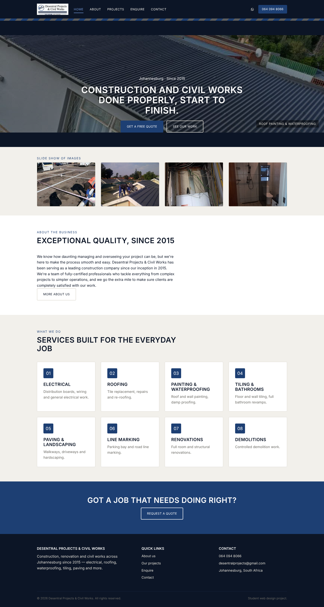 | 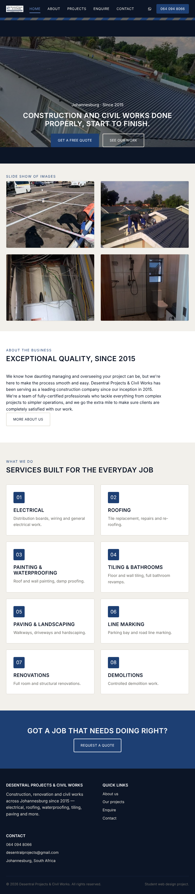 | 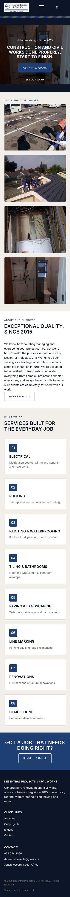 |

Mobile nav menu, open:

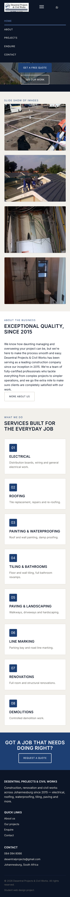

### About

| Desktop | Tablet | Mobile |
|---|---|---|
| 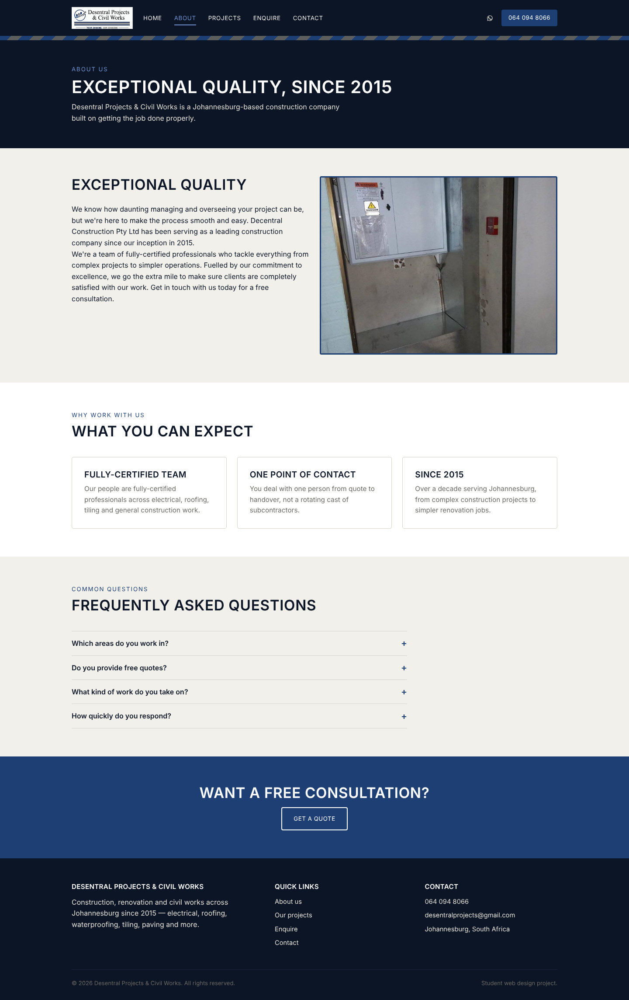 | 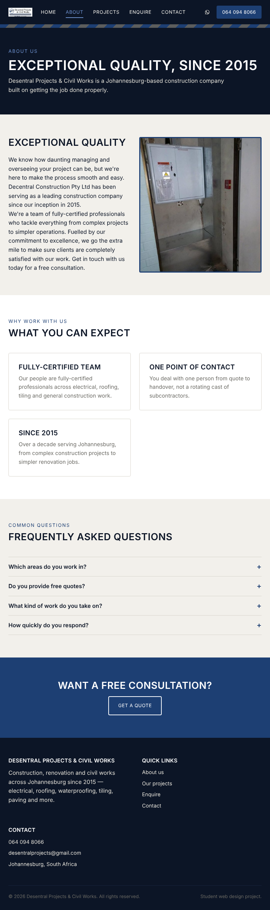 | 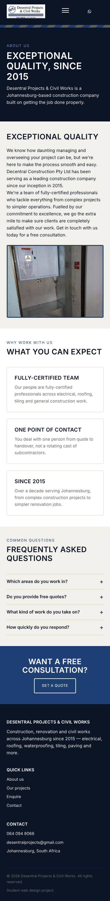 |

### Projects

| Desktop | Tablet | Mobile |
|---|---|---|
| 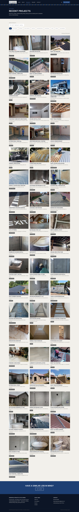 |  |  |

### Enquiry

| Desktop | Tablet | Mobile |
|---|---|---|
| 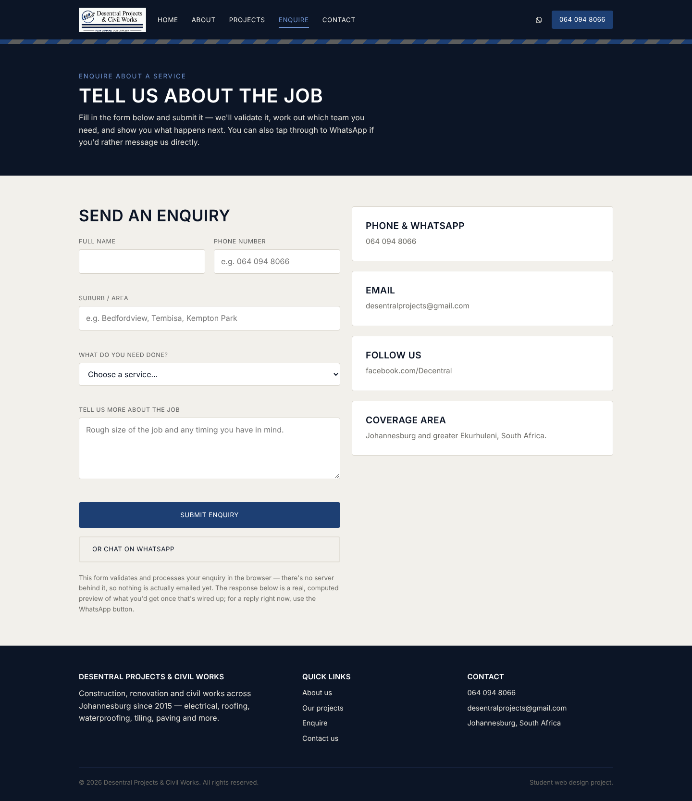 | 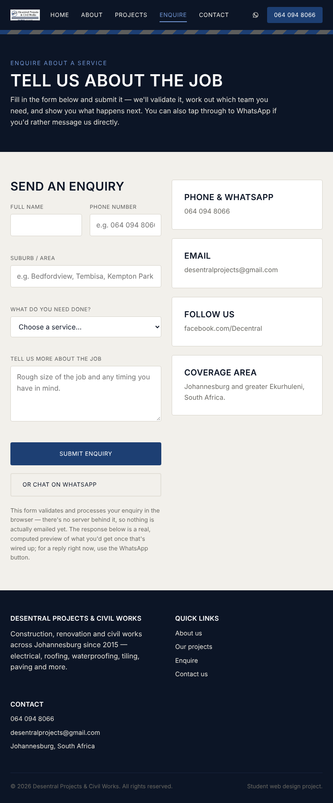 | 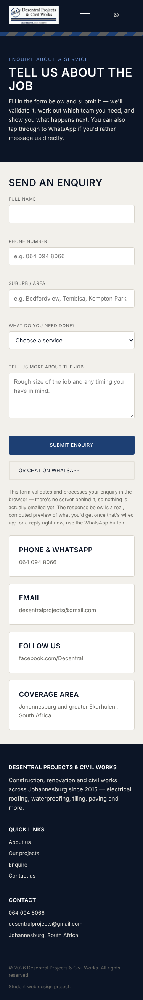 |

### Contact

| Desktop | Tablet | Mobile |
|---|---|---|
| 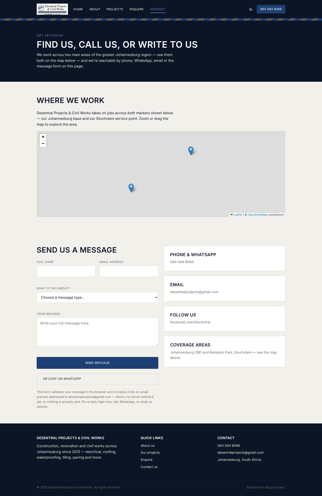 | 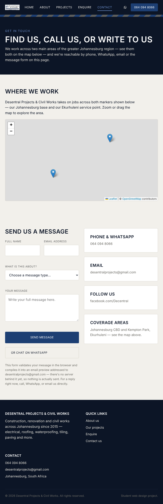 | 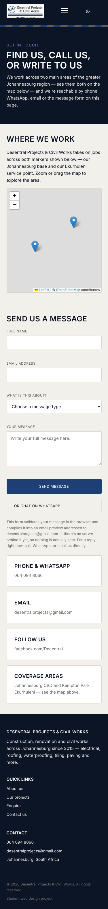 |

### Gallery Admin

| Desktop | Tablet | Mobile |
|---|---|---|
| 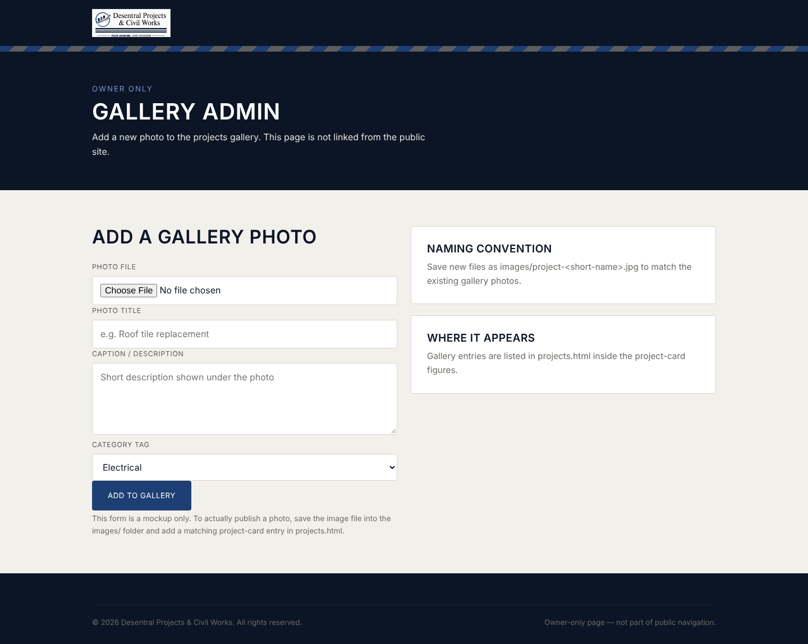 | 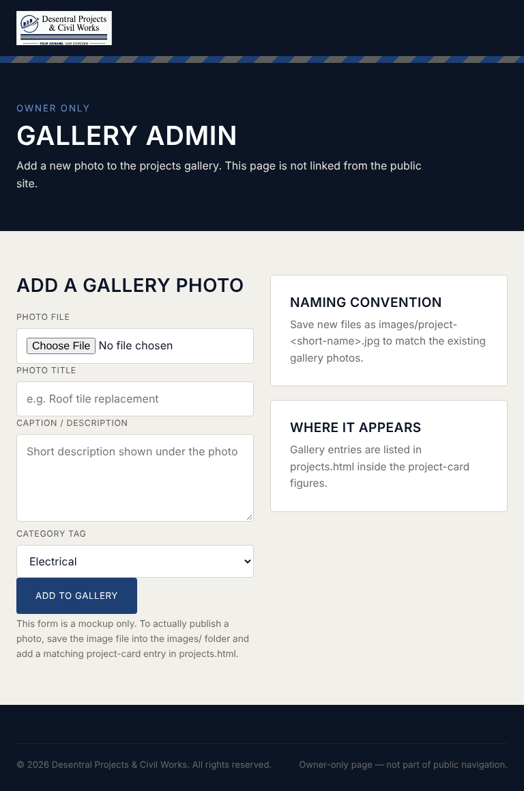 | 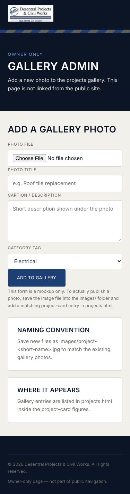 |


## Changelog

### Part 2 feedback — 95/100
The submitted Part 2 build was marked **95/100**, with full marks on the
external stylesheet, default style, typography, layout, decoration,
pseudo-classes, layout/typography/nav/image adjustment, commits, README
and references. The only mark dropped was 2/10 on media queries and
breakpoints and 3/10 on the Part 1 feedback-correction section — no written
comments were given alongside the numeric marks, so no further line-by-line
corrections have been made against that section for Part 3; the existing
responsive breakpoints have been kept as they were and extended to the two
new pages.

### Part 3 — Enhancing Functionality and SEO
- Renamed `quote.html` to `enquiry.html`; added new `contact.html`.
- Added a missing `<main>` element to every page.
- Updated every page's navigation and footer links for the new page set.
- Added a Leaflet + OpenStreetMap interactive map to `contact.html` with
  two coverage-area markers (Johannesburg CBD, Kempton Park).
- Added real client-side validation to the enquiry and contact forms, with
  an honest "no backend yet" compiled-preview response instead of a fake
  submission.
- Added live search, trade-tag filtering, and a click-to-enlarge lightbox
  to the 58-photo project gallery.
- Added a four-question FAQ accordion to `about.html`.
- Added `<meta name="keywords">` to every public page, reviewed all titles
  and descriptions, added `robots.txt` and `sitemap.xml`.
- Vendored Leaflet 1.9.4 locally (`js/leaflet.js`, `css/leaflet.css`)
  instead of loading it from a CDN.
- Verified no broken internal links and no JavaScript console errors across
  all six pages using a headless browser.
- Re-captured desktop/tablet/mobile screenshots including the two new pages.

### Part 1 feedback corrections
*(no written Part 1 feedback has been supplied to action against — see
note above.)*

### Part 2 — recoloured to match the logo
- Sampled the actual logo file (`images/Logo_1.jpg`) for its colours: a
  navy blue (`#1d3f73`-ish) and a neutral steel grey (`#5c5d5d`-ish), both
  used in the icon's bar chart and the horizontal stripe under the
  wordmark.
- Renamed the `--orange`/`--orange-dark` tokens to `--accent`/`--accent-dark`
  and recoloured them navy, since the accent no longer resembles orange.
  Recoloured `--charcoal`/`--charcoal-soft` from neutral near-black to a
  navy-black, and `--steel` from its old navy-ish value to the logo's
  actual grey, so it now genuinely represents the grey brand colour rather
  than duplicating navy.
- Recoloured the `.hazard` divider stripe from the old orange/black
  diagonal to a navy/grey diagonal, echoing the logo's own horizontal
  navy/grey/navy stripe under the wordmark.
- Added a third token, `--accent-light` (`#6f93d1`), after testing surfaced
  a real contrast bug: text sitting on the new navy-black backgrounds
  (nav links, the page-banner eyebrow, footer link hovers, social icons)
  was rendering navy-on-navy and was barely legible. `--accent-light` is
  used specifically for text/borders on dark surfaces; `--accent` stays
  for button fills and text on light backgrounds.

### Part 2 — CSS styling and responsive design
- Added `css/style.css`, linked from all five pages: reset, custom-property
  design tokens, typography scale, layout, component styling.
- Implemented responsive design with three breakpoints (desktop, tablet
  ≤1024px, mobile ≤640px); multi-column grids collapse appropriately at
  each breakpoint and the nav becomes a toggled mobile menu.
- Added `srcset`/`sizes` responsive images for the carousel, slideshow
  thumbnails, and About hero photo, with resized 480w/800w/1200w variants
  generated into `images/responsive/`.
- Added `loading="lazy"` to all 58 Projects gallery images.
- Fixed a contrast bug found during testing: the "See our work" outline
  button was rendering dark-on-dark over the carousel photo.
- Fixed missing vertical spacing between headings and the elements that
  follow them (a side effect of the CSS reset zeroing all margins by
  default) — added a default `margin-bottom` to `h2`/`h3` in the base
  typography rules.
- Hid the per-slide caption badge on tablet widths, where it was
  overlapping the carousel's call-to-action buttons.
- Captured desktop/tablet/mobile screenshots of all five pages as evidence.

### Part 2 — removed JavaScript (scope correction)
- Removed `js/script.js` and every `<script>` tag — the brief for this
  part covered CSS and responsive design only, so the site was pure
  HTML/CSS with no JavaScript anywhere (JavaScript returns, deliberately,
  in Part 3 above).
- Rebuilt the mobile nav toggle as a CSS-only checkbox + `<label>` pair
  (`:checked ~` sibling selector) instead of a JS click handler — kept
  as-is in Part 3.
- Rebuilt the home page carousel as a CSS `@keyframes` cross-fade with
  staggered `animation-delay` per slide — kept as-is in Part 3.
- Reworked the quote form's call-to-action into a plain `<a href="wa.me/...">`
  link with a generic pre-filled message, since a script-free page couldn't
  read the form's field values at the time.
- Converted the gallery-admin mockup from a `<form>` with a submit button
  to plain labelled fields with a `disabled` button.


## References

Referenced per **The IIE's Harvard-Anglia style guide** (2026 edition).

Desentral Projects & Civil Works, [s.a.]. *Desentral Projects & Civil
Works*. [Facebook] Available at: <https://www.facebook.com/Decentral>
[Accessed 20 August 2026].

OpenStreetMap contributors, 2026. *OpenStreetMap*. [Online] Available at:
<https://www.openstreetmap.org/copyright> [Accessed 26 October 2026]. Map
tiles and map data © OpenStreetMap contributors, used under the Open
Database License.

Agafonkin, V., 2026. *Leaflet* (Version 1.9.4). [Software] Available at:
<https://leafletjs.com/> [Accessed 26 October 2026]. Used under the
BSD 2-Clause licence; the library file is vendored locally in `js/leaflet.js`.

*(All project photos in `images/` were supplied by the site owner and
sourced from the company's own Facebook page, referenced above.)*


## Known limitations / next steps

- **No real backend**: neither the enquiry form nor the contact form
  actually sends an email — there's no server to send it from. Both pages
  say this openly and show a genuine computed preview of what each
  submission would contain. Wiring either form to a real inbox would need
  a backend endpoint or a form-handling service.
- **Admin page**: `admin.html` is a front-end mockup only — the "Add to
  gallery" form does not submit anywhere or touch the file system. Adding
  a new photo currently means manually saving the file into `images/` and
  adding a matching `project-card` entry in `projects.html`.
- **Responsive images**: `srcset`/`sizes` is implemented for the featured
  carousel, thumbnail strip, and About hero photo. The 58-photo Projects
  gallery uses `loading="lazy"` instead, given the number of images
  involved.
- **Map tiles need internet**: the Leaflet map on `contact.html` loads its
  tile imagery from the public OpenStreetMap servers at view time, so it
  needs an internet connection even though the page itself is static.


## Contact (as shown on the site)

| | |
|---|---|
| Phone / WhatsApp | 064 094 8066 |
| Email | desentralprojects@gmail.com |
| Facebook | facebook.com/Decentral |
| Coverage areas | Johannesburg CBD & Kempton Park, Ekurhuleni, South Africa |
